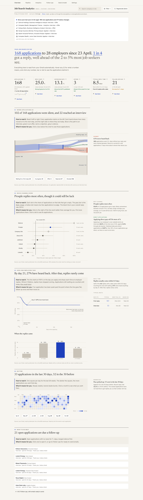
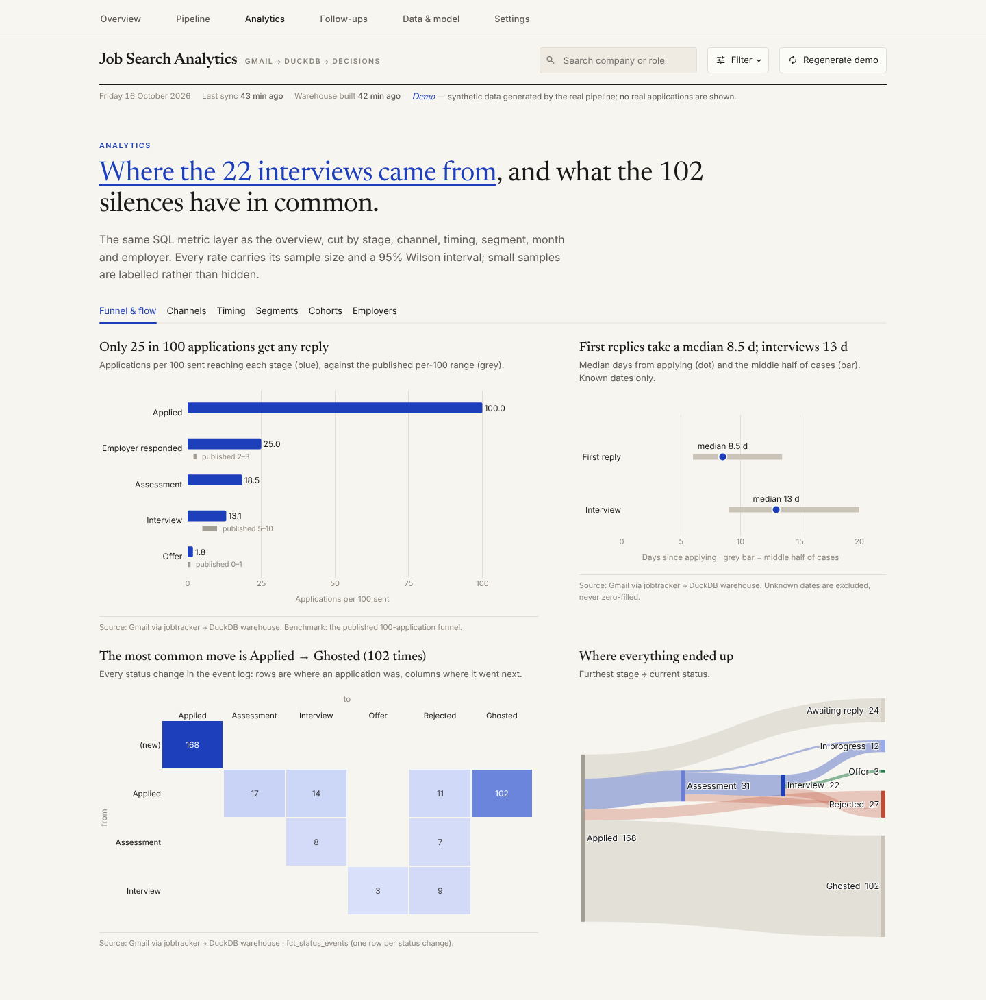
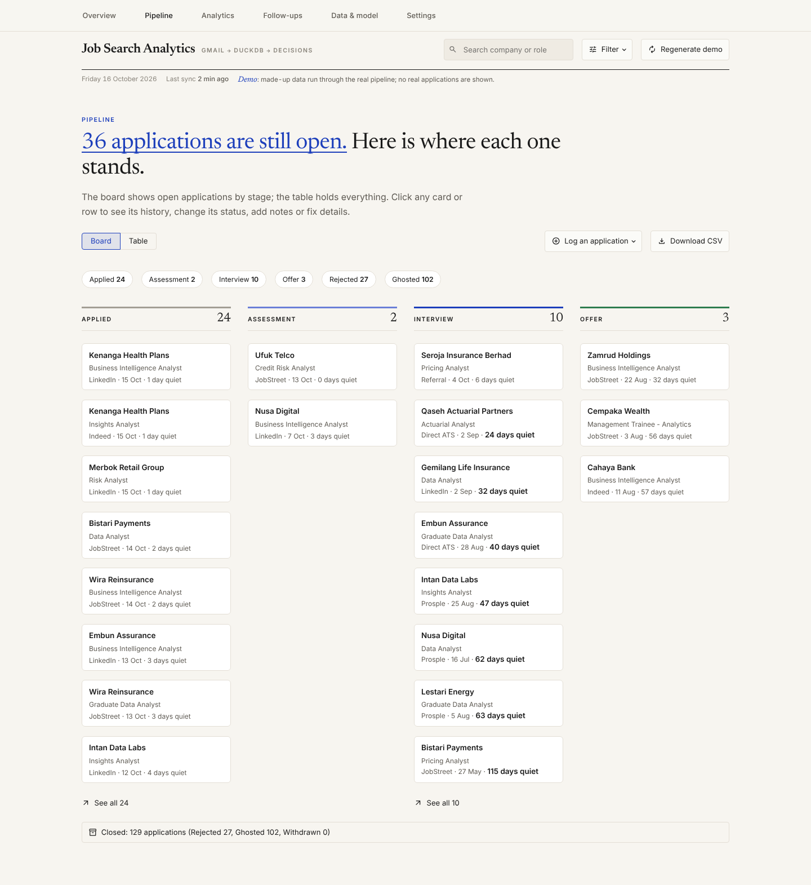
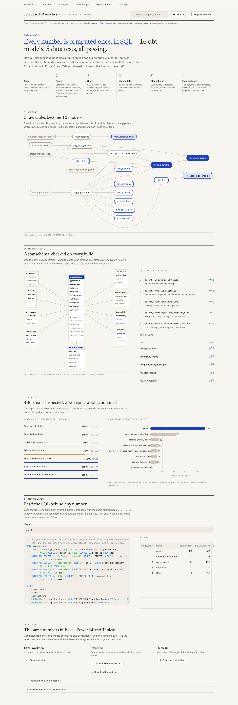
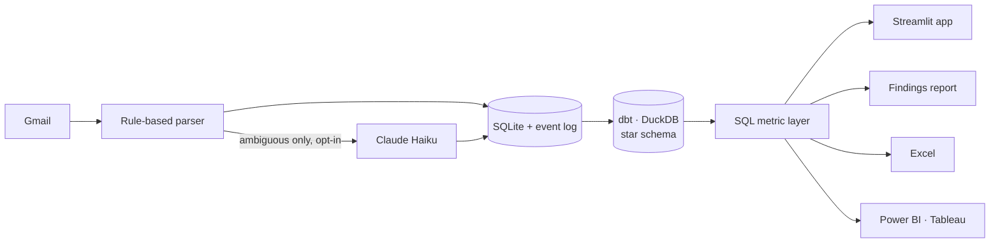

# Job Search Analytics

**My job hunt, run like a data product.** Gmail in; a tested star schema, one SQL metric
layer, a Streamlit app, a written findings report and an Excel / Power BI / Tableau pack out.

[](https://github.com/fariserhan/job-application-tracker/actions/workflows/ci.yml)


[](https://job-application-tracker-fxg5em5e9udlqzbv5zrruu.streamlit.app/)
[](https://fariserhan.github.io/job-application-tracker/)

**[Open the live demo →](https://job-application-tracker-fxg5em5e9udlqzbv5zrruu.streamlit.app/)**
(synthetic data) · **[Browse the warehouse docs and lineage →](https://fariserhan.github.io/job-application-tracker/)**



_Screenshots use the synthetic demo dataset — a generated inbox run through the real
pipeline. No real application data is in this repository._

## What it does

1. **Reads my job-application email** from Gmail (read-only OAuth), quota-aware and
   incremental.
2. **Separates real application events from noise** — job alerts, digests, account emails,
   marketing — with a deterministic rule engine whose accuracy is
   [measured on a labelled 261-email corpus](docs/parser-evaluation.md) and gated in CI:
   97.7% event F1 on a blind holdout never used for tuning (the v1 parser: 85.7%). Ambiguous
   emails can optionally get a second opinion from Claude Haiku: rules first, one cached
   call per email, a hard monthly budget (≈ US$0.0001 per email).
3. **Keeps an append-only history** of every status change, dated by the email that caused
   it, in SQLite.
4. **Models it into a star schema with dbt on DuckDB** — staging, milestones, facts and
   dimensions, covered by 50 data tests.
5. **Defines every KPI once, in SQL** — response and interview rates with Wilson 95%
   intervals, a Kaplan–Meier curve for time to first reply, funnel vs published benchmarks,
   cohorts, channel effectiveness — and serves that one definition to every surface.

## The surfaces

| | |
|---|---|
|  | **Analytics** — funnel and Sankey flow, channel effectiveness with confidence intervals and the 6.87% direct-application benchmark, Kaplan–Meier reply times, cohorts, segments. |
|  | **Pipeline** — kanban and table views, a per-application timeline built from the event log, notes, manual corrections, and logging applications that never sent an email. |
|  | **Data & model** — the live dbt lineage graph, data-test results, coverage audit, the noise-filter audit and every metric's SQL. |

The app is designed like a data-journalism page rather than a dashboard of cards: every
section leads with a sentence written from the data, charts are titled with their takeaway,
and the page assembles itself in sequence — the headline underlines itself, numbers count
up, the Sankey flows stage by stage — all switched off under `prefers-reduced-motion`. The
palette is checked for colour-blind separation, and the Excel / Power BI / Tableau pack
uses the same one.

Plus **Follow-ups** (who to chase, with draft emails), **Settings**, a written findings
report (`python -m jobtracker report` → [sample](docs/sample-report.md)), and a BI pack
(`python -m jobtracker export`): an Excel workbook with live formulas and native charts,
star-schema CSVs, DAX measures, a Power BI theme and Tableau calculated fields — see
[docs/bi](docs/bi/).

## Architecture



Details and the design decisions behind them: [docs/architecture.md](docs/architecture.md).

**Built to be honest about its data.** The funnel counts the furthest stage each application
reached, so a rejection after an interview still counts as an interview. Unknown reply dates
stay NULL instead of being zero-filled (a dbt test enforces it). Waiting applications are
censored in the survival analysis instead of dropped. Every rate shows its confidence
interval, because one person's job search is a small sample.

## Quick start

```bash
python -m venv venv && venv/bin/pip install -r requirements.txt   # Windows: venv\Scripts\...
python -m jobtracker demo                        # synthetic inbox through the real pipeline
JOBTRACKER_DATA_DIR=demo_data streamlit run app/streamlit_app.py
```

With your own Gmail: [docs/setup.md](docs/setup.md) (about 5 minutes for the OAuth client),
then `python -m jobtracker sync` or the **Sync Gmail** button. On Windows,
`launch_app.bat` starts the app.

```text
python -m jobtracker sync [--full]   pull Gmail -> parse -> store -> warehouse
python -m jobtracker report          written findings from your own data
python -m jobtracker export          Excel workbook + Power BI / Tableau pack
python -m jobtracker eval            parser accuracy on the labelled corpus
python -m jobtracker check           data-quality audit
```

## Engineering

- `jobtracker/` — typed Python package: `parsing/`, `store/` (versioned migrations,
  automatic backups), `gmail/` (batched, adaptive quota pacing), `warehouse/` (extract-load,
  a dependency-free runner for the dbt models, the metric layer), `bi/`, `report.py`.
- `dbt/` — the warehouse. CI runs real `dbt build`; the app runs the same SQL files
  through the built-in runner, so end users don't need dbt installed.
- `tests/` — hermetic pytest suite (no network, temp data): merge rules, the v1 → v2
  migration, metric results cross-checked against reference implementations, the SSRF
  guard on the posting scraper, the Claude fallback's budget and cache, the app's pages.
- CI on Linux and Windows across Python 3.11–3.13: ruff, mypy, tests, the parser accuracy
  gate, and `dbt build` + docs.

## Privacy

Gmail access is read-only. Email bodies stay in the local SQLite cache and never enter the
warehouse or any export. The Claude fallback is off unless you turn it on, and then only
ever sees emails the rules could not classify. The hosted demo runs on synthetic data only.
