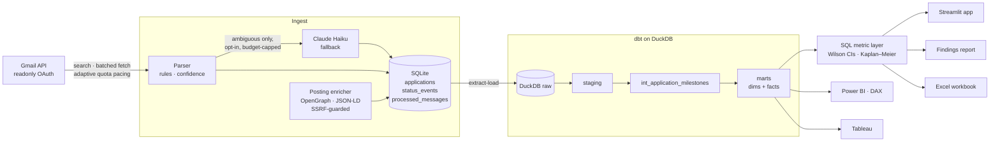
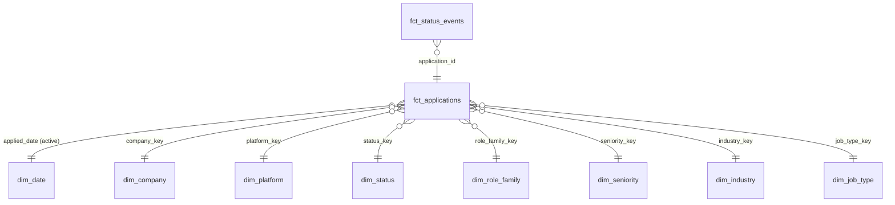

# Architecture

## 1. Ingest

**Search.** Two Gmail queries are unioned: one over ~60 job-board / ATS / assessment-vendor
sender domains, one over subject terms and body phrases (so employer-hosted ATS domains
nobody can enumerate still match). Known marketing templates are subtracted. Spam is
included — Gmail occasionally misroutes real confirmations there.

**Fetch.** Metadata first (From / Subject / Date / snippet), bodies only when the first-pass
verdict needs one; hard-blacklisted mail never costs a body download. Requests go in
50-message batches, three batches in flight on independent HTTP connections, all sharing
one adaptive pacer that starts at Gmail's quota-safe rate, speeds up on clean responses and
backs off on 403/429/5xx. A watermark plus a two-day overlap means a message whose fetch
failed is always seen again; sanitised bodies are cached so a full re-parse is offline.

**Parse.** `jobtracker/parsing` is a deterministic rule engine:

| Stage | What it decides |
|---|---|
| `classify.py` | Is this a real application event? Ordered tiers: hard blacklist → strong affirmation → response wording → known-platform loose tier. Every verdict carries a confidence. |
| `status.py` | Which pipeline status the email evidences (rejection > offer > interview > assessment > applied when several match). |
| `extract.py` | Employer and role from subject templates, body phrasing, sender display name, ATS tenant subdomain — with a quality gate that refuses platform names, pronouns and sentence fragments. |
| `categorize.py` | Job type, seniority, industry, role family. |
| `llm.py` | Optional Claude Haiku second opinion for *ambiguous* verdicts only (see below). |

Parser quality is measured, not asserted: `python -m jobtracker eval` scores it against a
labelled corpus (`tests/fixtures/email_corpus.jsonl`) and CI fails below the gate — see
[parser-evaluation.md](parser-evaluation.md).

**The Claude fallback** is off by default and built to be cheap: rules first (clear-cut mail
never leaves the machine), Claude Haiku at low effort with thinking off, ~1,500 characters of
trimmed text, a cached system prompt, structured JSON output, one call per message ever
(cached by Gmail message id) and a hard monthly budget. Typical cost ≈ $0.0001 per
ambiguous email.

## 2. Operational store (SQLite)

| Table | Grain | Notes |
|---|---|---|
| `applications` | one application (Gmail thread or manual entry) | current state |
| `status_events` | one status change | append-only, **dated by the email that caused it**, with a `source` (gmail / manual / system / repair / legacy / inferred / llm) |
| `processed_messages` | one Gmail message | parse verdict + sanitised body cache (bodies never leave this table) |
| `llm_calls` | one Claude call | cache + cost ledger |

Merge rules (`Repository.apply_message`): validity is an OR across the thread; status only
moves on newer evidence and a generic email never demotes an interview; a platform name
never replaces a real employer; `last_updated` advances only when a message changes
something, so "days waiting" means what it says. Schema changes are versioned migrations
(`PRAGMA user_version`); a v1 database is upgraded in place after an automatic backup.

## 3. Warehouse (dbt on DuckDB)

| Layer | Models |
|---|---|
| sources | `raw.applications`, `raw.status_events`, `raw.processed_messages` (body column excluded) |
| seeds | `status_stages` (funnel order, terminal / active / employer-response flags), `platform_channels` (job board vs employer site) |
| staging | `stg_applications` (valid rows only, typed, NULLs for unknowns), `stg_status_events` (stage + date-trust flag), `stg_messages` |
| intermediate | `int_application_milestones` — furthest stage reached, first trusted response date, assessment / interview / offer dates |
| marts | `fct_applications`, `fct_status_events`, `dim_*` (hashed surrogate keys), `rpt_application_analysis` (flat view for BI), `mart_parser_quality` |

**Two ways to run the same SQL.** CI runs real `dbt build` (models + 50 data tests) and
publishes `dbt docs`. The app runs the same model files with `warehouse/runner.py`, a
~150-line executor that resolves `ref` / `source` / `config`, topologically sorts the models
and runs the singular data tests — so end users need neither dbt nor its 100 MB of
dependencies. Anything outside that Jinja subset fails loudly, and CI's `dbt build` keeps
the two honest.

Builds are atomic: the warehouse is written to a fresh file and swapped in with
`os.replace`, so the app never reads a half-built model and a failed build leaves the
previous warehouse untouched.

**Design decisions worth defending in an interview**

- *Funnel on furthest stage, not current status.* The v1 tracker counted a rejection after
  an interview as "Applied", which made Assessment → Interview read 100% and hid real
  interviews. `max_stage_reached` comes from the event log.
- *Event dates from the email, not the sync.* v1 stamped status changes with the sync time,
  so every response looked instant. Migrated v1 events are kept but flagged low-trust and
  only used for timing when they are later than the application date.
- *NULL, never zero.* An unknown reply date is excluded from timing metrics; a dbt test
  enforces that no non-response carries a `days_to_response`.

## 4. Metric layer

`jobtracker/warehouse/metrics.py` holds every analytic as one SQL statement over the marts,
each starting from a filtered `base` CTE so sidebar filters apply uniformly. Highlights:

- **Wilson score intervals** on every rate (well-behaved at small n and near 0 / 100%).
- **Kaplan–Meier survival** for time to first reply — applications still waiting are
  right-censored instead of dropped (dropping them makes employers look faster than they
  are). Window functions compute the at-risk set and the cumulative product.
- Funnel with `LAG` step conversion and the published per-100 benchmark per stage.
- Sankey flows, weekly velocity with a 4-week rolling average and running total, monthly
  cohorts (with a maturity flag), segment breakdowns, follow-up queue, transition matrix,
  and a self-audit (`data_quality`).

The same definitions are emitted as Excel formulas, DAX measures and Tableau calculated
fields by `jobtracker/bi`, and tests check each against the SQL result.

## 5. Surfaces

- **Streamlit app** (`app/`): overview, pipeline (kanban + table + detail timeline),
  analytics, follow-ups, data & model (live lineage graph, data tests, SQL viewer), settings.
- **Findings report** (`python -m jobtracker report`): a written analysis with hedged
  conclusions — only called a finding when the intervals say so.
- **BI pack** (`python -m jobtracker export`): Excel workbook with live formulas and native
  charts, star-schema CSVs, DAX measures, Power BI theme, Tableau calculations. See
  [bi/](bi/).
